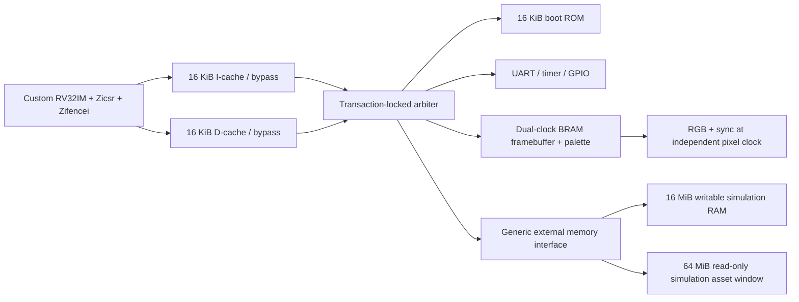

# Chip: Custom FPGA Doom SoC

A simulation-first, board-independent computer built from original SystemVerilog.
The custom RV32IM machine-mode CPU runs bare-metal DoomGeneric, with no Linux,
MMU, borrowed CPU core, or host-side rendering shortcut.

**Current result:** two complete Verilator runs executed the same six-frame
Freedoom demo segment through the real RTL CPU. Guest game tics advanced from
2 to 7; all captures matched between runs and matched an independent Unicorn
execution byte-for-byte. This is a short acceptance segment, not a completed
7,117-tic timedemo or physical-board demonstration.

**Hardware is not ready.** Vivado implementation and board bring-up have not run.
The Boolean Board has no external writable runtime RAM. An 8-16 MiB RAM expansion
or another board is necessary; flash cannot replace writable RAM. Modern
Freedoom additionally requires a larger asset backend than the board's 16 MiB
QSPI flash. See [STATUS.md](STATUS.md) before treating any feature as complete.

## Architecture



- Serialized, in-order CPU with precise traps, timer interrupt, DSP multiplication,
  iterative division, permanent x0 and retirement/trap-event trace.
- Independent instruction/data interfaces; stable valid/ready requests and responses.
- Two 16 KiB caches, 32-byte lines, burst refills, reset/fence invalidation,
  write-through data stores and uncached MMIO.
- Two 320x200 indexed-color BRAM pages, RGB888 palette and blank-only flips.
  Scanout doubles pixels to a vertically centered 640x400 image in 640x480 timing.
- No external-memory display DMA. Refresh bandwidth stays inside the FPGA.
- Bare-metal startup, trap diagnostics, drivers, allocator, diagnostic libc,
  Doom/newlib bindings, firmware artifacts and verified asset packaging.

## Prerequisites

Python 3.12 or newer, Git, Icarus Verilog, Verilator with a native C++ compiler,
Make, and a RISC-V GNU toolchain with RV32IM/ILP32 newlib. Windows portable-tool
setup, exact downloads and checksums are in [docs/tooling.md](docs/tooling.md).
Firmware setup is in [docs/software.md](docs/software.md).

```sh
python -m pip install -r tools/requirements.txt
python software/fetch_doomgeneric.py
python scripts/build_firmware.py all doom test
```

The build produces ELF, binary, disassembly, linker map and memory initialization
images under ignored `firmware/build/`. No script silently installs a compiler
or changes permanent PATH/Git settings.

## Build And Test

Run commands from the repository root:

| Task | Command |
| --- | --- |
| SystemVerilog lint/elaboration | `python scripts/run.py lint` |
| Unit and software tests | `python scripts/run.py unit` |
| Seeded CPU and protocol checker tests | `python scripts/verify_all.py cpu monitors` |
| Official ISA tests | `python tools/isa_tests.py all` |
| Firmware artifacts | `python scripts/build_firmware.py all doom test` |
| Graphical RTL diagnostic | `python scripts/run.py soc --frames 1 --prefix diagnostic` |
| Exact diagnostic pixels | `python tools/verify_frame.py --diagnostic build/soc/diagnostic_1.ppm` |
| Independent functional Doom | `python tools/functional_soc.py --frames 6` |
| Saved Doom results and bandwidth | `python scripts/check_doom.py` |
| Yosys XC7 resource assessment | `python scripts/synth_yosys.py --rom-budget` |
| Vivado synthesis, when installed | `vivado -mode batch -source scripts/vivado.tcl -tclargs synth` |
| Vivado implementation, when installed | `vivado -mode batch -source scripts/vivado.tcl -tclargs impl` |

Formal prove/cover commands and assumptions are in [formal/README.md](formal/README.md).
They prove divider completion/control and arbiter safety, not the entire CPU/SoC.

## Doom Simulation

Download legally redistributable Freedoom separately using the verified archive
instructions in [docs/software.md](docs/software.md). WADs are never source files
in this repository. The tested asset is Freedoom 0.13.0 `freedoom1.wad`, 28,795,076
bytes, SHA-256 `7323bcc168c5a45ff10749b339960e98314740a734c30d4b9f3337001f9e703d`.

```sh
python tools/assets.py external/assets/freedoom1.wad firmware/build/wad.mem --backend flash --format mem --size 28795076 --sha256 7323bcc168c5a45ff10749b339960e98314740a734c30d4b9f3337001f9e703d
python scripts/run.py soc --firmware firmware/build/doom.mem --wad firmware/build/wad.mem --frames 6 --cycles 950000000 --prefix doom_final_a
python scripts/run.py soc --no-build --firmware firmware/build/doom.mem --wad firmware/build/wad.mem --frames 6 --cycles 950000000 --prefix doom_final_b
python scripts/check_doom.py
```

The exact golden binary uses GCC 15.2.0 as documented. Other compiler versions
may change code layout and cycle counts; do not silently overwrite the golden
manifest. The two measured runs each took about 12.5 minutes on the local host.
Simulation speed depends heavily on the host and simulator version.

## Results

| Evidence | Result |
| --- | --- |
| Directed CPU tests | 21,726 trace events per run; three latency seeds passed |
| Divider tests | 264,632 operand/mode cases passed |
| Independent arithmetic retirement | 4,196 instructions per seeded run matched Unicorn |
| Official ISA execution | 94 applicable binaries passed; exclusions documented |
| Bus/cache/peripheral/video tests | Passed randomized and directed checks |
| Formal | Scoped divider, arbiter and UART FIFO-control induction proofs and covers passed |
| Full RTL Doom segment | 6 frames, 626,567,682 cycles, 87,905,457 retirements |
| External traffic | 83,780,800 bytes; 6.686 MB/s including startup |
| Steady observed frame interval | 39,480,000 cycles, about 1.27 rendered FPS at 50 MHz |
| Dense-ROM XC7 mapping | 11,629 LUTs including nominal LUTRAM, 2,673 FF, 46 BRAM36 equivalents, 5 DSP |
| Vivado / physical hardware | Not executed |

The 60 Hz-ish output refresh is independent of Doom's much slower rendering rate.
FIFO and CDC simulations are not hardware metastability or timing signoff.

## Documentation

- [Architecture](docs/architecture.md) and [memory/register map](docs/memory-map.md)
- [CPU and trace](docs/cpu.md), [official ISA results](docs/isa-tests.md), [bus/cache](docs/bus.md)
- [Video](docs/video.md), [software/assets](docs/software.md), [simulation](docs/simulation.md)
- [Verification](docs/verification.md), [functional emulator](docs/emulator.md), [synthesis](docs/synthesis.md)
- [Boolean Board boundary](docs/boolean-board.md), [prototype audit](docs/prototype-audit.md)

Code is MIT (see `LICENSE`). DoomGeneric keeps its GPL licence; see
`THIRD_PARTY.md` before distributing a linked binary.
