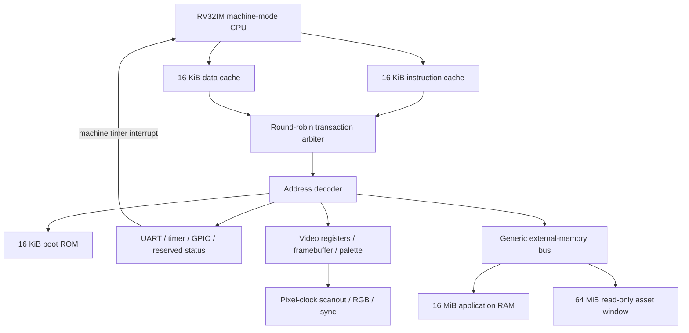

# Implemented Architecture

This describes the SystemVerilog in `rtl/` and its firmware bindings, not a
proposed board implementation. The exact address and register contract is in
[Memory Map](memory-map.md). CPU verification scope is in [CPU](cpu.md).

## System Boundary



ASCII equivalent (external storage is supplied by the integration):

```text
                       +-- I-cache --+
RV32IM CPU ------------+             +-- arbiter -- decoder -- boot ROM
                       +-- D-cache --+                    +-- peripherals
                                                         +-- video -- RGB/sync
                                                         +-- external bus
                                                               +-- RAM
                                                               +-- assets
```

`rtl/soc/soc_top.sv` is board-independent. It accepts CPU and pixel clocks,
separate active-low resets, UART RX, GPIO inputs, and external-memory responses;
it emits UART TX, GPIO outputs, RGB888, syncs, active-video, memory requests,
retirement/trap trace, and simulation UART enqueue events. It does not instantiate
clock-generation primitives, physical RAM/flash controllers, a hardware loader,
HDMI/TMDS circuitry, or a usable board wrapper. Reset deassertion must be
synchronized to the respective clock domain by the integration.

## CPU

`rtl/core/rv32im_cpu.sv` implements little-endian RV32I and all eight M operations,
Zicsr, and `FENCE.I`, in machine mode only. There is no compressed instruction
support, MMU, supervisor/user execution, floating point, or atomic extension.
Reset PC defaults to zero; all integer registers reset to zero and x0 stays zero.

Execution is a **non-overlapped, in-order finite-state machine**, not a pipeline:
`FETCH -> IF_REQ -> IF_WAIT -> EXEC`, followed as necessary by
`MEM_REQ -> MEM_WAIT`, `DIV_WAIT`, or `FENCE_WAIT`. Only after completion does
the next instruction begin. Separate instruction/data ports do not imply
overlapped instructions or one-instruction-per-cycle throughput. Multiplication
uses a combinational product; division uses 32 restoring iterations, with a
divide-by-zero shortcut and the RISC-V signed-overflow behavior.

Loads/stores check architectural alignment before issuing a request. The bus
address is always word-aligned; stores shift data and byte strobes, while loads
select a byte/halfword and sign/zero extend the full returned word in the CPU.
This is especially important for side-effecting MMIO reads; see the memory map.

`FENCE` retires as a no-op because transactions already complete in order.
`FENCE.I` waits for instruction-cache invalidation. It does not invalidate the
data cache. `WFI` is an implemented no-op, not a clock gate or sleep state.

Traps are precise at instruction boundaries. Implemented synchronous causes
are instruction address misalignment (0), instruction access fault (1), illegal
instruction (2), breakpoint (3), load misalignment/access fault (4/5), store
misalignment/access fault (6/7), and machine ECALL (11). The only interrupt is
machine timer interrupt (`mcause = 0x80000007`), sampled in `FETCH` when both
`mstatus.MIE` and `mie.MTIE` are set. Outstanding operations finish before IRQ
delivery. Trap entry saves PC/cause/value and MIE into MPIE, clears MIE, and
retains machine MPP. `MRET` restores MIE from MPIE and resumes at `mepc`.
`mtvec` supports direct mode and vectored interrupt mode; exceptions always use
the base. Trace order increments for retirement and trap entry, but `minstret`
increments only for retirement.

### Machine CSRs

All CSR accesses are 32-bit instruction operations, not MMIO. Unknown CSRs and
attempted writes to the explicitly read-only CSRs trap as illegal instructions.
CSRRS/CSRRC and immediate counterparts with a zero source field are reads without
a write; CSRRW/CSRRWI always attempt a write. Fixed WARL registers below accept
and ignore writes, rather than trapping.
The table covers all 24 decoded CSR addresses, including counter high halves.

| Address | Name | Access / Reset | Implemented Behavior |
| --- | --- | --- | --- |
| `0x300` | `mstatus` | RW / `0x00001800` | MPP fixed machine (`0x1800`); only MIE bit 3 and MPIE bit 7 writable (`0x88`). |
| `0x301` | `misa` | Fixed WARL / `0x40001100` | RV32, I and M; writes ignored. |
| `0x304` | `mie` | RW / 0 | Only MTIE bit 7 writable. |
| `0x305` | `mtvec` | RW / 0 | Base aligned to 4 bytes; mode 1 retained, all other requested modes become 0. |
| `0x306` | `mcounteren` | Fixed WARL / 0 | Writes ignored; no lower privilege mode exists. |
| `0x310` | `mstatush` | Fixed WARL / 0 | RV32 high status half; all implemented fields fixed zero, writes ignored. |
| `0x340` | `mscratch` | RW / 0 | Full 32-bit scratch register. |
| `0x341` | `mepc` | RW / 0 | Writes clear bits 1:0; trap entry records faulting/interrupted PC. |
| `0x342` | `mcause` | RW / 0 | Full 32-bit value; trap entry overwrites it. |
| `0x343` | `mtval` | RW / 0 | Full 32-bit value; trap entry supplies address, illegal instruction, or zero as appropriate. |
| `0x344` | `mip` | Fixed WARL / live | Bit 7 reflects timer IRQ, others zero; writes ignored. Reset timer makes it zero. |
| `0xB00`, `0xB80` | `mcycle`, `mcycleh` | RW / 0 | Low/high halves of 64-bit cycle count, incremented each non-reset CPU clock. |
| `0xB02`, `0xB82` | `minstret`, `minstreth` | RW / 0 | Low/high halves of 64-bit retired-instruction count. |
| `0xC00`, `0xC80` | `cycle`, `cycleh` | RO / 0 | Aliases of machine cycle counter halves. |
| `0xC02`, `0xC82` | `instret`, `instreth` | RO / 0 | Aliases of machine retirement counter halves. |
| `0xF11`..`0xF14` | `mvendorid`, `marchid`, `mimpid`, `mhartid` | RO / 0 | All return zero. |
| `0xF15` | `mconfigptr` | RO / 0 | No configuration structure is supplied; writes trap. |

Counter reads return the value before that instruction's retirement edge.
Writing a machine counter half preserves the other half and overrides that
edge's normal increment, including `minstret`'s increment for the writing
instruction. There is no `time` CSR or `mcountinhibit`; use timer MMIO for time.

## Caches And Bus

Each `direct_mapped_cache` has 16 KiB of data: 512 direct-mapped lines of
32 bytes (eight 32-bit words). Address bits 13:5 index the line, 31:14 are the
tag, and 4:2 select a word. Reads use registered RAM lookup. A miss requests
one eight-word burst at the aligned line base and waits for the complete refill
before responding. Any refill error or incorrect termination rejects the line.

Stores are write-through, no-write-allocate. Every store reaches external RAM
and waits for acknowledgement; a successful store hit merges strobed bytes
into the cached word. A failed hit store invalidates the line. There are no
dirty lines or writeback. Reset and an accepted cache fence sweep one valid bit
per clock, **512 clocks** per sweep, without resetting data/tag RAMs. The CPU's
total `FENCE.I` latency also includes handshake/retirement overhead.

`cache_port.sv` caches the 16 MiB RAM window and reads of the 64 MiB asset
window. ROM, MMIO, framebuffer, and asset writes bypass caching. There is no
external-master snooping; an external writer can leave cached data stale.
The integrated D-cache has no software invalidation operation: its invalidation
input is tied low. `FENCE.I` sweeps only the I-cache, while `FENCE` sweeps neither.
The standalone hardware fence interface is described in [Bus](bus.md).

`soc_pkg::req_t` contains address, write flag, four byte strobes, 32-bit data,
and `len` (beats minus one). `rsp_t` contains 32-bit data, error, and last.
Valid/ready handshake accepts a request or response once; payload must remain
stable while stalled. Supported transactions are aligned single-word accesses
(`len=0`) and eight-word reads (`len=7`) to RAM/assets. Bursts must remain wholly
inside the region. Stores are single-word only. The arbiter holds its grant
under request backpressure, alternates priority after completed transactions,
and holds ownership until the last response is accepted. The shared bus has
only one outstanding transaction and no IDs, retries, or timeout mechanism.

The external bus is synchronous to **`cpu_clk`**. A bridge must retain this
protocol, including backpressure, errors, and final-beat indication. A memory
controller on another clock requires an external CDC bridge; `soc_top` does not
provide one. `sim_ram.sv` is a randomized-delay behavioral model, not a physical
memory controller. It initializes its array to zero once, optionally preloads
it, and does not clear the array on reset.

## Video And Clocks

The SoC simulation uses 50 MHz CPU and 25 MHz pixel clocks. `CLK_HZ` (default
50,000,000) describes the supplied CPU clock for UART baud calculation; it neither
generates the clock nor rescales `mtime`, which increments on every non-reset
CPU clock. Firmware's `CPU_HZ` must match that actual timer frequency. Video
totals are 800 pixels by 525 lines, giving approximately
**59.52 Hz at 25 MHz**. A board wrapper can supply 25.175 MHz for approximately
**59.94 Hz**, without changing raster counts.

The active raster is 640x480. A 320x200 indexed image is doubled in each axis
to 640x400, centered vertically at lines 40..439; the remaining visible rows
are black. Active-low horizontal sync spans counts 656..751 and vertical sync
lines 490..491. Framebuffer and palette reads are two synchronous memory stages;
sync and visibility masks follow the same latency. `active_video` describes
the 640x480 visible raster even when image output is disabled.

Two pages contain 64,000 valid pixel bytes each, on separate 64 KiB strides.
The unused tail of each stride faults, not aliases. The 256-entry RGB888
palette and framebuffer have no reset initialization. Reset disables image
output and resets the output mask, guaranteeing black RGB despite undefined
memory contents; software must initialize palette/pixels before enabling.

Page requests cross to the pixel clock using a toggle and stable bundled page
value. Scanout changes page during vertical blank (lines 480..524), then returns
an acknowledgement toggle. Only one flip may be pending. Enable, acknowledgement,
and vblank status use synchronizers. Palette/framebuffer use dual-clock memory
ports; modifying the displayed page or palette is not an atomic frame update.

## Firmware And Storage

The ROM's default three-instruction stub, also supplied by `firmware/boot.S`,
executes `FENCE.I` and jumps to `0x80000000`. This assumes application RAM has
already been preloaded; it is not a loader. `start.S` establishes gp/sp,
disables interrupts, installs a fatal trap handler, initializes data, clears
BSS, and calls `main`. The diagnostic initializes both pages and the RGB332
palette, enables output, requests page 1, checks WAD bounds, and polls timer,
UART, and GPIO. The Doom binding converts RGB32 pixels to RGB332, writes the
back page, and submits a vblank flip; there is no audio implementation.

Assets are separate from the unchanged 16 MiB application RAM. Freedoom 0.13.0
Phase 1 is **28,795,076 bytes**, or **28,795,140 bytes** including the 64-byte
`CHWAD001` header. This exceeds both a 16 MiB asset allocation and the entire
16 MiB RAM, so RAM repartitioning cannot solve capacity. The implemented
read-only simulation window is expanded to **64 MiB** at `0x60000000`.
This is an address-space/model adjustment, not 64 MiB of on-chip FPGA RAM or
evidence of physical flash support. A 16 MiB Boolean-board flash would still
be too small for this complete image; physical storage and loading remain
unresolved. See [Software](software.md) for packaging and provenance and
[Boolean Board](boolean-board.md) for hardware integration limits.

Measured results and their limits are in [Verification](verification.md) and
[Simulation](simulation.md).
